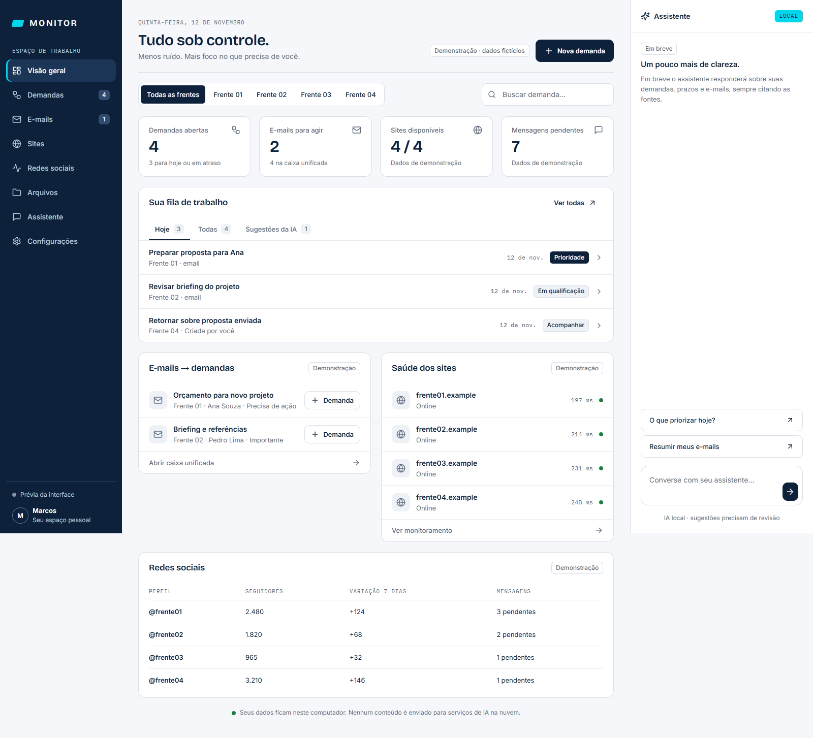
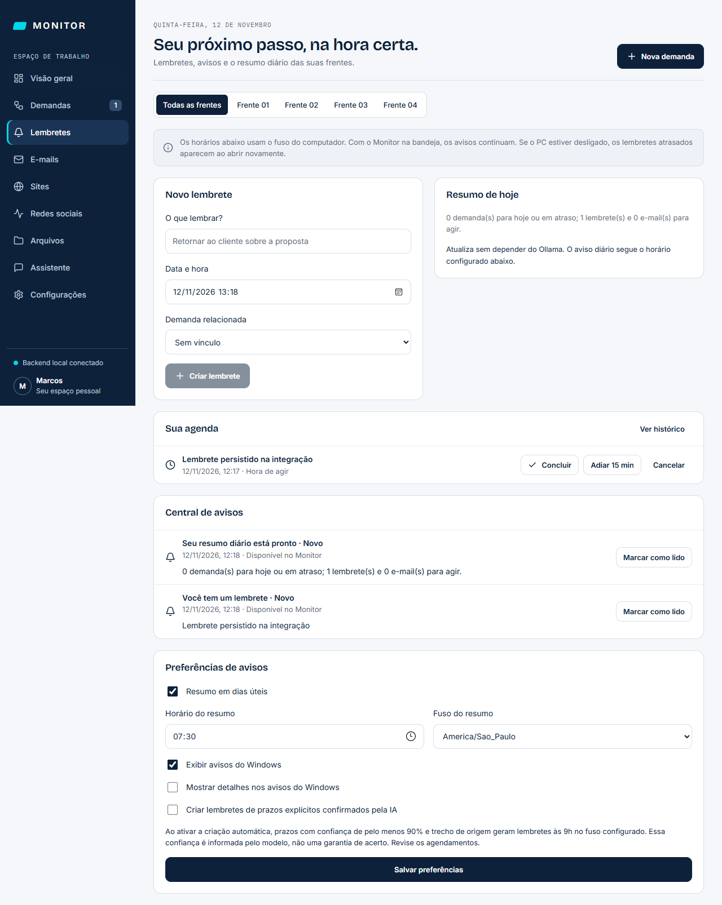
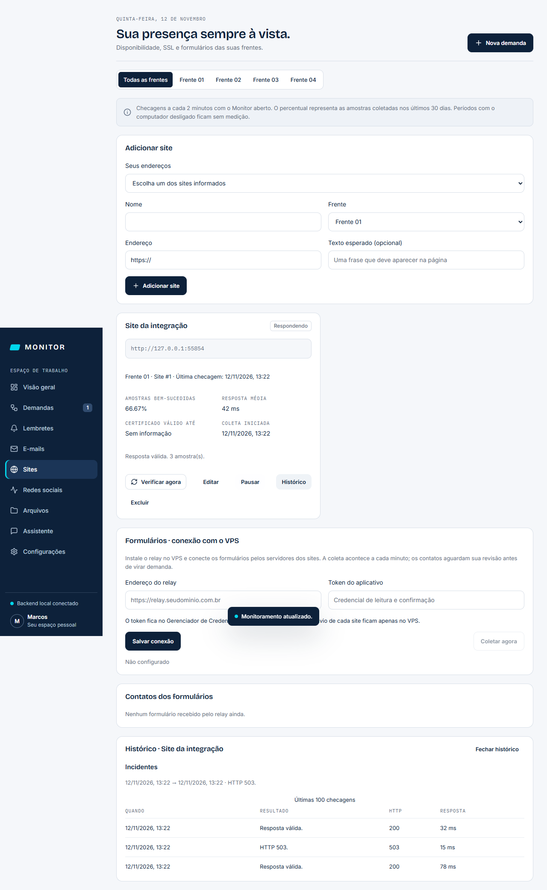

# Monitor

Central de operação pessoal com IA local para reunir demandas, e-mails, acompanhamento comercial, sites, redes sociais e arquivos.

**Estado: versão `0.8.0-alpha.1`.** Demandas, kanban, e-mails IMAP, triagem local, sugestões, pasta de arquivos, backups, exportação, agenda e central de avisos. Agora inclui checagens dos sites e fila de formulários com relay para VPS. O assistente conversa com o modelo local sobre os seus dados e as demandas com data podem ir para o [Google Agenda](docs/AGENDA-GOOGLE.md). Perfis do [Instagram](docs/REDES-SOCIAIS.md) aparecem em cartões com os números da semana; perfil, frentes e cores são personalizáveis e o aplicativo [se atualiza](docs/ATUALIZACOES.md) por um botão. WhatsApp e catálogo de arquivos ainda não foram entregues. Consulte a [validação](docs/VALIDATION.md).

## Objetivo



- Monitorar várias caixas de e-mail e sugerir demandas para revisão.
- Criar demandas manualmente e acompanhar a próxima ação comercial.
- Acompanhar disponibilidade dos sites e funcionamento dos formulários.
- Coletar métricas e comentários do Instagram com o Chrome oculto e criar demandas de pedidos comerciais.
- Catalogar arquivos locais e pastas sincronizadas do OneDrive.
- Conversar com um assistente local que consulta registros e executa pedidos diretos de lembretes e demandas.

Pedidos diretos no assistente criam e alteram lembretes e demandas com resultado registrado. A triagem de e-mails continua gerando sugestões para revisão. E-mails não são enviados, apagados ou movidos.

## Referências

- [Especificação completa](prompt-codex-monitor.md)
- [Protótipo das telas](<Monitor — Protótipo.pdf>)
- [Fases e critérios de entrega](docs/ROADMAP.md)
- [Regras de interface](docs/DESIGN.md)
- [Notas da primeira release](docs/releases/v0.0.1.md)

O briefing e o PDF são referências de produto, não demonstrações de funcionalidades implementadas. Modelos, métricas e requisitos de provedores deverão ser validados durante a implementação.

## Arquitetura prevista

```text
app/
  backend/       Python 3.12, FastAPI, SQLModel, SQLite, APScheduler
  frontend/      React, Vite, TypeScript
  desktop/       Tauri 2 e sidecar Python
relay/           Serviço de eventos no VPS, FastAPI e Docker
scripts/         Build Windows, avaliações e ferramentas futuras
docs/            Planejamento e documentação
```

Backend, frontend e desktop contêm as Fases 1 a 3 e a primeira entrega da Fase 4. O relay já pode ser configurado e instalado no VPS; monitor externo, métricas do host e teste semanal dos formulários continuam pendentes.

O aplicativo será instalável no Windows. O Ollama executará a IA no PC; o relay receberá eventos enquanto o PC estiver desligado. Monitoramento externo deverá detectar indisponibilidade do próprio VPS.

O banco em uso fica em `%LOCALAPPDATA%\Monitor`, fora de pastas sincronizadas, porque o SQLite aberto dentro do OneDrive pode corromper. Backups diários, exportações e arquivos organizados vão para a **pasta de arquivos**, que você escolhe no instalador ou em Configurações, normalmente dentro do OneDrive. Senhas ficam no Gerenciador de Credenciais do Windows. O modelo local será configurável e testado no hardware disponível, sem promessa prévia de desempenho ou precisão.

## Desenvolvimento

Requisitos Windows: Node 22+, Python 3.12, Rust estável, C++ Build Tools e WebView2 ([pré-requisitos Tauri](https://v2.tauri.app/start/prerequisites/)).

A coleta do Instagram usa o Google Chrome instalado e os perfis locais do Instagram Prospect. O Playwright é empacotado no backend; não é necessário baixar outro navegador. Consulte [Redes sociais](docs/REDES-SOCIAIS.md) para conectar contas e entender a cobertura.

```powershell
python -m venv .venv
.venv/Scripts/python.exe -m pip install -c app/backend/requirements-dev.lock -e 'app/backend[dev]'
npm ci
npm run tauri -- dev
```

O Tauri inicia o backend automaticamente. `MONITOR_PYTHON` permite indicar outro interpretador. Para dados fictícios, defina `$env:MONITOR_DEMO='1'` antes de abrir. Banco real em `%LOCALAPPDATA%\Monitor\monitor.db`; demo em `demo.db`, separado.

`npm run dev` inicia apenas uma prévia no navegador. Clique em **Explorar demonstração**; alterações nessa prévia ficam em memória e se perdem ao recarregar. A prévia não acessa o banco real.

```powershell
.venv/Scripts/python.exe -m pytest app/backend/tests
npm test
npm run build
./scripts/build_windows.ps1 -Python .venv/Scripts/python.exe
```

O script gera o sidecar com PyInstaller, testa o executável e compila os instaladores NSIS/MSI em `dist/`. O workflow Windows desktop faz o mesmo no GitHub Actions. Os instaladores não têm assinatura Authenticode. As assinaturas próprias do atualizador são geradas no build com a chave guardada no segredo protegido do repositório; elas não removem os avisos do SmartScreen.

Para validação sem ativar inicialização automática, execute o binário com `--no-autostart`. `--no-notifications` desativa a ponte de avisos nativos na sessão de teste. O MSI usa a versão interna numérica `0.8.0.1`.

Ollama é separado do instalador. Em Configurações, verifique a disponibilidade, ajuste o modelo e solicite o download. Sem Ollama, as regras continuam triando os e-mails e as mensagens aguardam na fila da IA.

## Lembretes e resumo diário

A seção **Lembretes** permite criar agendamentos gerais ou vinculados a demandas, concluir, cancelar e adiar. A central registra avisos e o resumo diário. Por padrão, o resumo é gerado às 7h30 em dias úteis no fuso America/Sao_Paulo e não depende do Ollama. Horário, fuso e privacidade dos avisos são configuráveis.



O aplicativo precisa estar aberto ou na bandeja. Com o computador desligado não há avisos; agendamentos atrasados são recuperados ao abrir novamente. A criação automática a partir de prazos explícitos nos e-mails começa desativada. Veja [como funciona a agenda](docs/AGENDA.md).

## Conversas com a IA

Na **Visão geral**, o assistente de trabalho usa os registros do Monitor para ajudar a priorizar demandas e prazos, citando as fontes. A tela **Assistente** organiza conversas gerais e de trabalho em uma lista: elas ficam salvas no computador e podem ser reabertas ou excluídas com confirmação. A conversa geral não coleta automaticamente os registros comerciais.

Pedidos explícitos de preferências de resposta podem virar memórias visíveis e apagáveis. Elas orientam o assistente, sem alterar automações operacionais do Monitor ou treinar os pesos do modelo. Veja [conversas e aprendizado](docs/ASSISTENTE.md). A IA continua local pelo Ollama, sem navegação na internet.

## Ícones das empresas

Os filtros das frentes exibem o ícone de cada empresa antes do nome. Para enviar seu favicon, abra **Configurações → Personalização → Frentes → Enviar ícone** e salve. PNG, JPG, WebP e ICO de até 5 MB são ajustados sem cortar o desenho; sem imagem, aparecem as iniciais.

## Sites e formulários

Em **Sites**, cadastre os endereços, escolha a frente e, se quiser, uma frase esperada no HTML. O Monitor consulta a cada dois minutos enquanto estiver aberto ou na bandeja, verifica status HTTP, tempo de resposta, texto e validade do certificado HTTPS. Há botão de checagem, pausa, edição, histórico, incidentes e avisos de falha/recuperação e vencimento próximo do certificado. Após cinco minutos sem coleta, o resultado aparece como antigo. O percentual representa amostras bem-sucedidas, não disponibilidade contínua durante períodos desligados.

Os quatro endereços informados estão disponíveis como sugestões, sem cadastro automático. A sugestão Rocha Comercial usa `https://rochacomercial.com.br`: em 12/11/2026, o domínio respondeu e a versão com `www` falhou no DNS da consulta local.



O **relay** recebe formulários no VPS, guarda os contatos em SQLite e entrega ao PC com confirmação após gravação local. Contatos aguardam revisão antes de virar demanda; duplicatas de transporte não criam novos registros. Credenciais de envio ficam nos servidores dos sites, nunca no JavaScript público. Veja [instalação e integração dos formulários](relay/README.md). O código inclui Docker/Coolify e exemplos; nenhuma alteração ou implantação foi feita no VPS ou nos sites reais.

Monitor externo independente do VPS, métricas de CPU/RAM/disco e teste sintético semanal ainda não foram implementados. Veja [como interpretar as checagens e o histórico](docs/SITES.md).

## Pasta de arquivos

O instalador `.exe` (NSIS) tem uma página para escolher a pasta; a sugestão é `OneDrive\Monitor`. A escolha fica em `HKCU\Software\Monitor\FilesDir` e pode ser trocada em Configurações. O instalador MSI não tem essa página; nele a pasta é escolhida no aplicativo. Dentro da pasta o Monitor cria `Backups` (cópia diária do banco, 14 mais recentes), `Entrada` e `Exportações`. Desinstalar não apaga a pasta.

A página usa um modelo NSIS próprio em `app/desktop/src-tauri/windows/`, copiado do `tauri-cli` 2.12.4 com uma linha a mais. Por isso a versão do `@tauri-apps/cli` está fixa; ao atualizá-la, copie o novo modelo e reaplique a linha marcada com `5b`.

## E-mails

Em Configurações, informe endereço, servidor IMAP, porta SSL (993), usuário e senha de cada conta e a frente a que pertence. O Monitor lê a caixa de entrada a cada 2 minutos com `EXAMINE` e `BODY.PEEK`: não marca como lida, não move e não apaga. Na primeira coleta traz os últimos 30 dias (até 200 mensagens).

Regras determinísticas valem mais que a IA: pedido de orçamento ou prazo com data vira “Precisa de ação”; confiança abaixo de 0,6 ou data ambígua vai para “Revisar”; publicidade fica como informativo; remetente prioritário ou cliente com demanda aberta é no mínimo “Importante”. A IA só sugere: a demanda nasce quando você aceita a sugestão.

Para medir a triagem com seus e-mails, rotule um CSV e rode:

```powershell
.venv/Scripts/python.exe scripts/eval_emails.py meus-emails.csv
```

O formato está em `docs/eval-exemplo.csv`.

## Contribuir

Veja [CONTRIBUTING.md](CONTRIBUTING.md). Relatos de problemas e propostas de melhoria são bem-vindos. Use apenas dados fictícios em exemplos.

## Licença

[MIT](LICENSE). Componentes e modelos de terceiros permanecem sujeitos às respectivas licenças. O projeto não é afiliado à Meta, Microsoft ou aos fornecedores citados.
